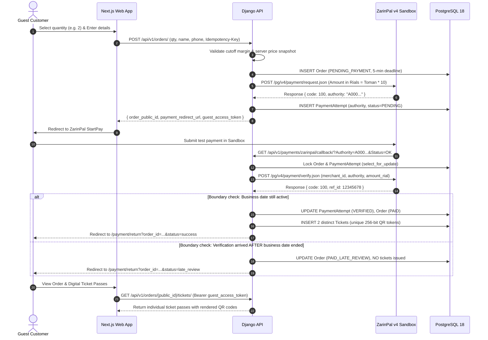

# Payment Lifecycle & State Machine

## 1. Sequence Diagram: Purchase to Ticket Issuance

---

## 2. Order State Machine Transitions

| Current State | Event | Target State | Notes |
|---|---|---|---|
| `*` | Order Initiated | `PENDING_PAYMENT` | Initial state with snapshot price and 5-min deadline |
| `PENDING_PAYMENT` | Verification succeeds before day cutoff | `PAID` | Generates 1..N unique tickets in same transaction |
| `PENDING_PAYMENT` | Verification succeeds AFTER day cutoff | `PAID_LATE_REVIEW` | Money captured, but admission day expired. Alert admin |
| `PENDING_PAYMENT` | Gateway returns NOK / User cancels | `PAYMENT_FAILED` | Safe terminal state |
| `PENDING_PAYMENT` | Payment deadline passes without verify | `EXPIRED` | Order expired, no tickets issued |
| `PAID_LATE_REVIEW` | Admin initiates refund | `REFUND_PENDING` / `REFUNDED` | Handled via admin manual workflow |
| `PAID` | Admin cancels entire order | `CANCELLED` | All child tickets set to `CANCELLED` |

---

## 3. Idempotency & Duplicate Protection
1. **Frontend Double-Submit**: A generated UUID v4 `Idempotency-Key` prevents double order creation on multiple button clicks.
2. **Duplicate Callback**: Gateway callbacks might trigger multiple times. If `PaymentAttempt.status == 'VERIFIED'` and `Order.status == 'PAID'`, subsequent callbacks return the existing order outcome without creating duplicate tickets or running verification twice.
3. **ZarinPal Code 101**: Code 101 signifies that this specific authority was already verified previously. The system accepts code 101 only if the local database already associates this authority with the corresponding order.

